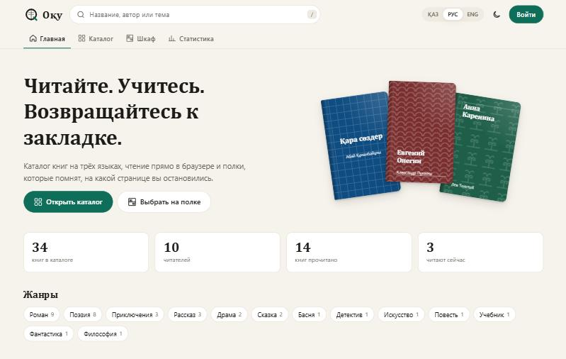
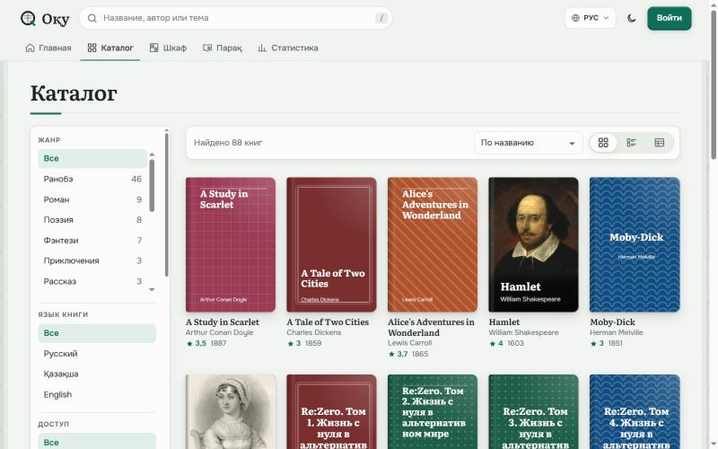
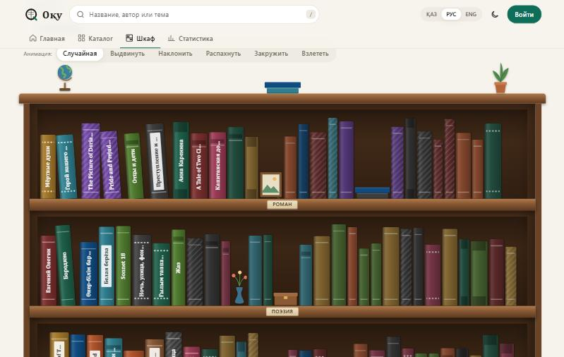
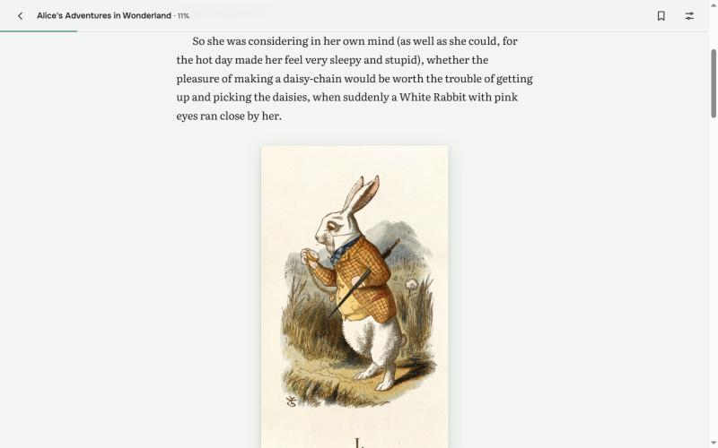
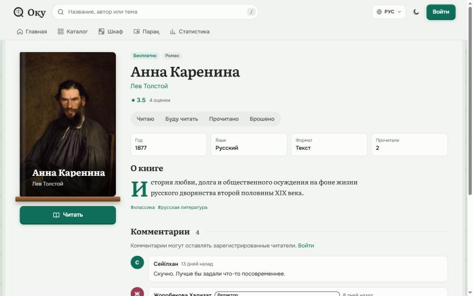
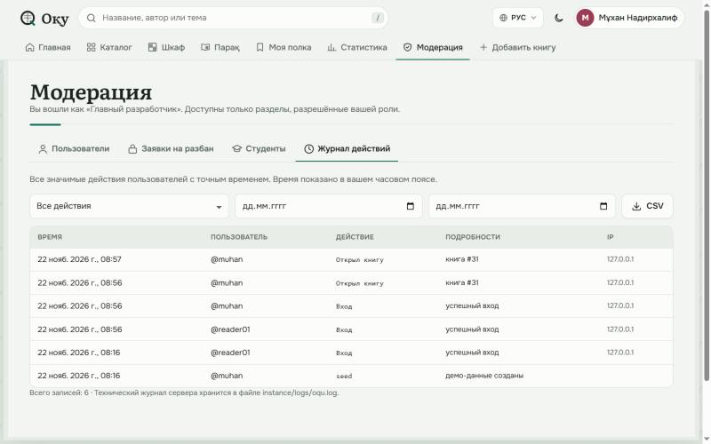
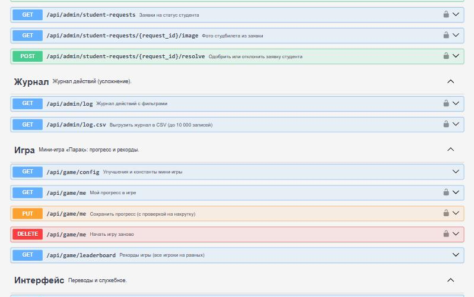
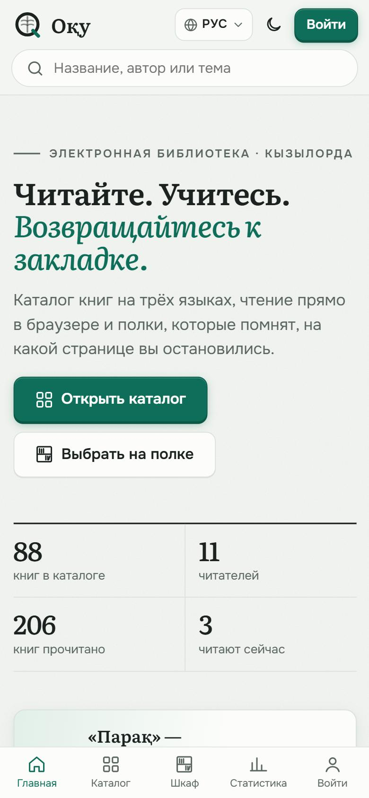
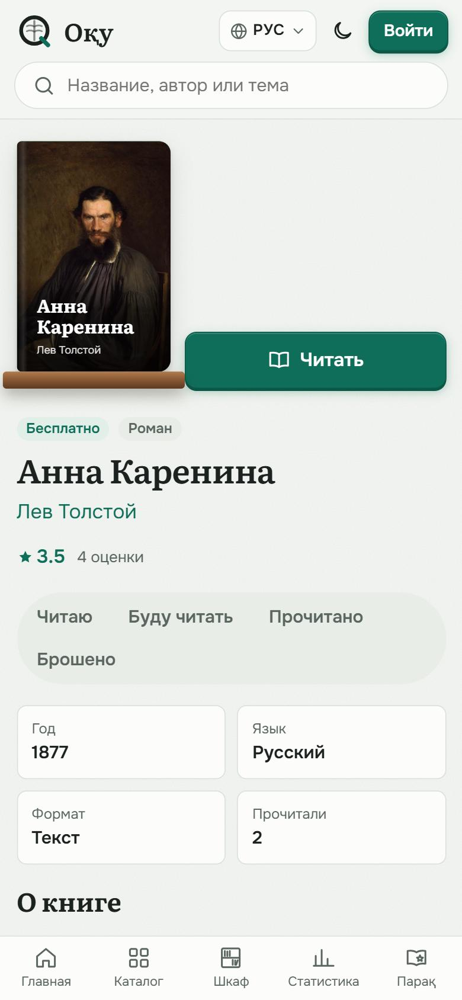
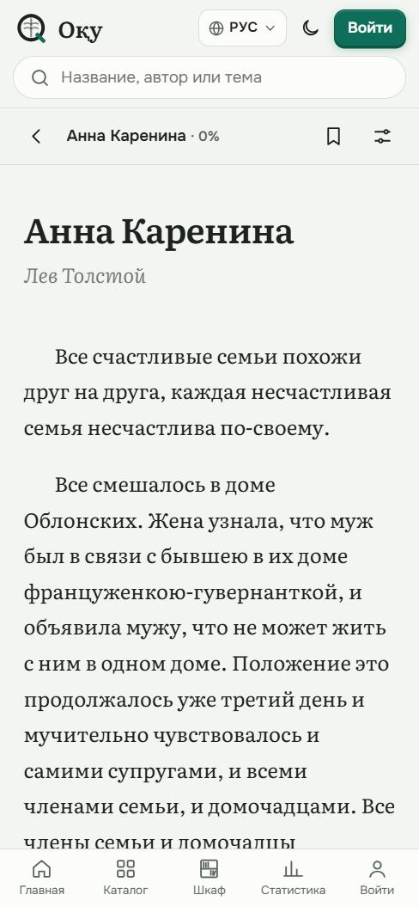

<div align="center">


# Оқу

**Электронная библиотека с REST API на FastAPI**

Каталог, чтение в браузере, полки и закладки, модерация и журнал действий.
Интерфейс на русском, казахском, кыргызском и английском.

[](https://130-17-21-59.sslip.io)
[](https://130-17-21-59.sslip.io/docs)


**[Открыть сайт](https://130-17-21-59.sslip.io)** &nbsp;|&nbsp; **[Документация API](https://130-17-21-59.sslip.io/docs)** &nbsp;|&nbsp; **[Документы проекта](docs/README.md)**

</div>



## О проекте

Курсовой проект по дисциплине «Разработка кроссплатформенных веб/мобильных/настольных приложений на Python» (Кызылординский университет имени Коркыт Ата, 2026).

Вариант 11: **библиотека REST API с документацией OpenAPI**. Обязательно: FastAPI, аутентификация JWT, постраничный вывод. Усложнение: журнал действий пользователей с временными метками.

По заданию нужен был сервер с API. Мы сделали и его, и полноценный сайт поверх него: всё, что умеет сайт, доступно через API, и наоборот.

## Задание и что сделано

| Требование варианта 11 | Как выполнено |
|---|---|
| REST API на FastAPI | 59 маршрутов, разбиты по разделам: книги, полки, комментарии, профиль, модерация, журнал |
| Документация OpenAPI | Swagger UI на `/docs`, ReDoc на `/redoc`, схема `/openapi.json`; у каждого маршрута описание и примеры |
| Аутентификация JWT | Токен доступа на 30 минут и токен обновления на 7 дней, пароли через PBKDF2 (600 000 итераций) |
| Постраничный вывод | Книги, комментарии, пользователи и журнал отдаются страницами: `page`, `page_size`, `total`, `pages` |
| Журнал действий с временными метками | Таблица `action_log`: кто, что, когда, с какого IP; фильтры, страницы, выгрузка в CSV, автоочистка через год |
| Бизнес-логика отдельно и с тестами | `app/service.py` не знает про HTTP; 155 тестов pytest, покрытие 89% |

**Сверх задания:**

- сайт (одностраничное приложение без сборки), который работает на компьютере и телефоне;
- 7 ролей с минимально нужными правами: главный разработчик, редактор, автор, модератор, студент, читатель, гость;
- читалка текста и PDF, продолжение с места остановки, закладки с заметками, иллюстрации и формулы LaTeX в тексте;
- полки «Читаю / Буду читать / Прочитано / Брошено», оценки 1-5, статистика чтения;
- книжный шкаф с анимациями (фирменный элемент сайта);
- платные новинки, которые студенты после проверки студбилета читают бесплатно;
- баны с причиной и сроком, заявки на разбан, фильтр нецензурных слов в комментариях (ru, kk, en);
- 4 языка интерфейса, светлая и тёмная темы;
- пользовательское соглашение и политика конфиденциальности по законам РК;
- мини-игра «Парақ» с таблицей рекордов и защитой от накрутки;
- рабочий сервер в интернете: nginx, HTTPS, systemd.

## Скриншоты

| Каталог | Книжный шкаф | Читалка |
|---|---|---|
|  |  |  |
| **Страница книги** | **Журнал действий** | **Swagger UI** |
|  |  |  |

<p align="center">
  
  
  
</p>

## Как работать с API

Откройте [`/docs`](https://130-17-21-59.sslip.io/docs): там можно вызвать любой маршрут прямо из браузера. Открытые маршруты (список книг, поиск, статистика) работают сразу, для остальных нужен вход.

```bash
# 1. Список книг, вторая страница по 10 штук
curl "https://130-17-21-59.sslip.io/api/books?page=2&page_size=10&sort=rating"

# 2. Вход: в ответе access_token и refresh_token
curl -X POST https://130-17-21-59.sslip.io/api/auth/login \
     -H "Content-Type: application/json" \
     -d '{"username": "логин", "password": "пароль"}'

# 3. Запрос с токеном
curl https://130-17-21-59.sslip.io/api/me -H "Authorization: Bearer <access_token>"
```

В Swagger то же самое: выполните `POST /api/auth/login`, скопируйте `access_token`, нажмите **Authorize** и вставьте его. Полный список маршрутов с правами доступа: [docs/11](docs/11_Описание_маршрутов_API.md).

## Безопасность

- пароли хранятся только в виде хэша PBKDF2-SHA256 с солью;
- после нескольких неверных паролей аккаунт временно блокируется, плюс лимит попыток входа с одного IP;
- все SQL-запросы параметризованы;
- секретный ключ JWT берётся из окружения или создаётся при первом запуске, в коде его нет;
- загружаемые PDF и картинки проверяются по сигнатуре, сохраняются под случайными именами;
- заголовки CSP, X-Frame-Options, nosniff, Referrer-Policy.

Подробно: [чек-лист безопасности](docs/12_Чек-лист_безопасности.md).

## Запуск у себя

```bash
python -m venv .venv
.venv\Scripts\activate            # Linux / macOS: source .venv/bin/activate
pip install -r requirements.txt
python -m app.seed                # демо-база: 88 книг, 11 пользователей
python -m uvicorn app.web:app --port 8000
```

Сайт откроется на <http://127.0.0.1:8000>, документация API на <http://127.0.0.1:8000/docs>.
В Windows можно просто дважды щёлкнуть `start.bat`: он сам найдёт Python, поставит зависимости, создаст демо-базу и откроет браузер.

Демо-аккаунты (пароль у всех `ChangeMe_2026`): `muhan` (главный разработчик), `khadizat` (редактор), `moder01` (модератор), `author01`, `author02` (авторы), `student01` (студент), `reader01`, `vladimir_p` (читатели), `applicant01` (ждёт проверки студбилета), `spammer01` и `banned01` (забанены).

Установка на Linux-сервер (nginx, systemd, HTTPS): [docs/13](docs/13_Инструкция_по_развёртыванию.md) и папка `deploy/`.

## Тесты

```bash
python -m pytest -q
python run_coverage.py
python -m ruff check --select E,W,F,N --line-length 79 app tests
```

155 тестов проходят, покрытие бизнес-логики 89%, замечаний PEP 8 нет. Проверяются обычные, граничные и ошибочные случаи: пустые поля, год 2101, цена больше миллиона, бан главного разработчика, накрутка в игре, миграция старой базы и т.д.

## Технологии

| Слой | Что используется |
|---|---|
| Сервер | Python 3.11+, FastAPI, Pydantic v2, uvicorn |
| Данные | SQLite (16 таблиц, режим WAL) |
| Вход | PyJWT, PBKDF2 из стандартной библиотеки |
| Интерфейс | HTML, CSS, JavaScript без фреймворков и сборки |
| Тесты и стиль | pytest, ruff (PEP 8) |
| Сервер в интернете | Ubuntu 24.04, nginx, systemd, Let's Encrypt |

## Структура

```
app/         service.py - бизнес-логика, db.py - база, web.py - REST API,
             schemas.py, security.py, profanity.py, seed.py, demo/
static/      css, js (core, views, game, admin), переводы ru/kk/ky/en,
             шрифты, vendor/temml, юридические тексты
templates/   index.html
tests/       test_service.py, test_game.py
deploy/      настройка сервера, nginx
docs/        документация (Markdown) и скриншоты
Для_сдачи/   документы Word, презентации, шпаргалка к защите
```

## Документация

В папке [`docs/`](docs/README.md): анализ аналогов, техническое задание, архитектура и схема БД, макеты, исходный код, план и отчёт тестирования, руководство пользователя, инструкция по установке, пояснительная записка, описание маршрутов API, чек-лист безопасности, развёртывание, пользовательское соглашение и политика конфиденциальности. Версии для печати (.docx) лежат в `Для_сдачи/1_Документы_Word/`.

## Сторонние материалы

- шрифты Literata и Onest: SIL Open Font License 1.1 (`static/fonts/*-OFL.txt`);
- Temml (формулы LaTeX в MathML): лицензия MIT (`static/vendor/temml/LICENSE`);
- тексты классики, портреты авторов и рисунки Джона Тенниела: общественное достояние (Викитека, Project Gutenberg, Wikimedia Commons; список в `app/demo/img/SOURCES.json`);
- «Гарри Поттер» и Re:Zero есть в каталоге только названиями, авторами, годами и нашими аннотациями, тексты и иллюстрации издателей не используются.

## Авторы

**Мұхан Надирхалиф** (главный разработчик) и **Жоробекова Хадизат** (редактор), группа Сиб-24-1 п/я.
Руководитель: Айтимов Мурат Жолдасбекович.
Связь: regulary_n@mail.ru
