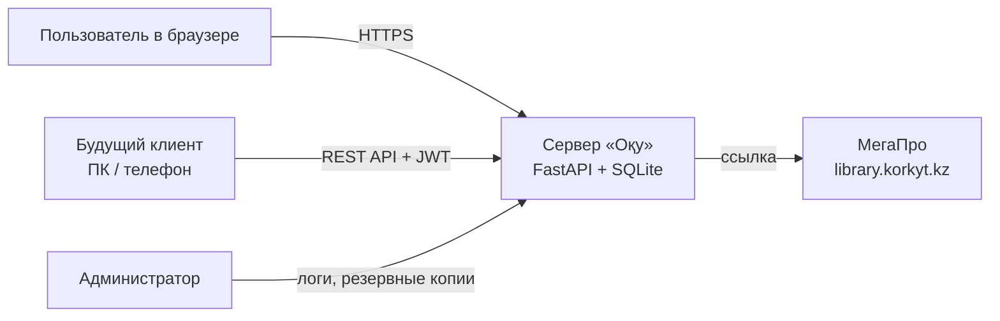
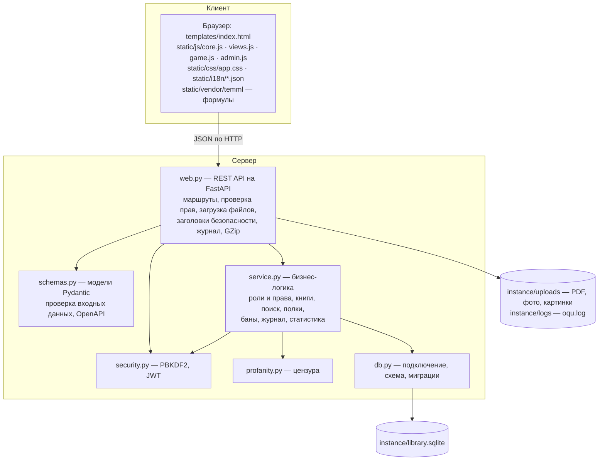
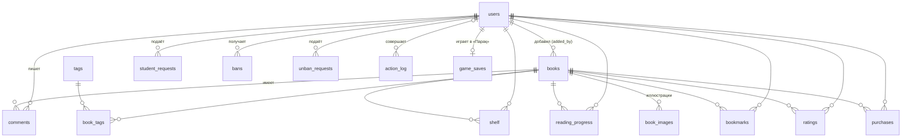
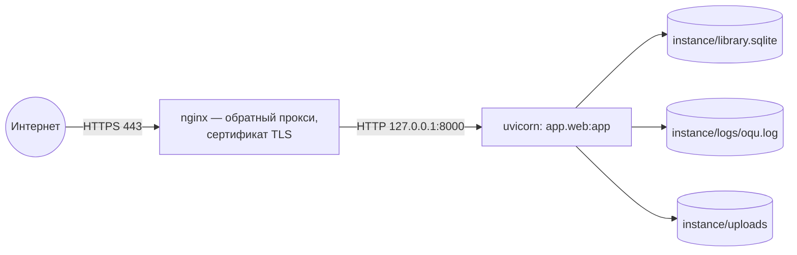

# Документ 3. Описание архитектуры и схема базы данных

**Проект:** «Оқу» · **Версия:** 2.0 от 21.11.2026

Описание построено по идеям ISO/IEC/IEEE 42010:2022: система рассматривается с нескольких точек зрения — контекст, компоненты, данные, поведение (вход по JWT), развёртывание — и для ключевых решений указаны альтернативы и причины выбора.

## 1. Назначение и контекст

«Оқу» — веб-приложение электронной библиотеки. С ним взаимодействуют:

- **пользователи** в браузере (компьютер или телефон) — через одностраничный интерфейс;
- **внешние программы** (будущие настольный и мобильный клиенты, скрипты) — через REST API;
- **электронная библиотека вуза МегаПро** — внешняя система, на которую ведут ссылки из карточек книг (данные не копируются);
- **администратор сервера** — через файлы журнала и резервные копии базы.



## 2. Компоненты (трёхуровневая схема)

Как в примере LabBooking из методички, система разделена на три уровня: **интерфейс — бизнес-логика — хранилище**. Интерфейсный уровень только принимает запросы и показывает результат; все правила находятся в `service.py`, который ничего не знает о HTTP. Поэтому ту же логику можно подключить к настольному или мобильному интерфейсу без изменений и проверить тестами без запуска сервера.



| Модуль | Ответственность | Не делает |
|---|---|---|
| `app/web.py` | Маршруты `/api/...`, зависимости `require_user` / `require_perm`, превращение ошибок логики в HTTP-коды, загрузка файлов, заголовки безопасности, кэш, лимит входа по IP, запись журнала | Не содержит правил предметной области |
| `app/schemas.py` | Контракт API: какие поля и в каких границах принимаются и возвращаются | Не обращается к базе |
| `app/service.py` | Все правила: права ролей, проверка данных, книги, поиск и пагинация, платный доступ, комментарии, полки, баны, заявки, журнал, статистика | Не знает про HTTP, FastAPI и HTML |
| `app/security.py` | Хэш паролей, выпуск и проверка JWT, параметры защиты от подбора | — |
| `app/profanity.py` | Поиск и маскирование нецензурных слов | — |
| `app/db.py` | Подключение к SQLite, создание таблиц, миграции, Unicode-функции `lower/upper` | Не содержит запросов логики |
| `app/i18n.py` | Отдаёт словари переводов через API | — |
| `app/seed.py` | Демонстрационные данные | — |
| Фронтенд | Одностраничное приложение: роутер по `#адресу`, вызовы API, переводы, анимации | Не хранит пароли; права только скрывают кнопки, решает сервер |

## 3. Схема базы данных

SQLite, 16 таблиц. Все внешние ключи включены (`PRAGMA foreign_keys = ON`), ограничения `CHECK` защищают данные даже при ошибке в коде. Время хранится строкой UTC `ГГГГ-ММ-ДД ЧЧ:ММ:СС` — такие строки сравниваются в том же порядке, что и даты, поэтому фильтры журнала по датам выполняются прямо в SQL.



### 3.1. Таблицы и поля

| Таблица | Поле | Тип и ограничения | Описание |
|---|---|---|---|
| **users** | id | INTEGER PK | Идентификатор |
| | username | TEXT UNIQUE NOT NULL | Логин |
| | email | TEXT UNIQUE NOT NULL | Почта |
| | password_hash | TEXT NOT NULL | Хэш `pbkdf2_sha256$итерации$соль$хэш` |
| | role | TEXT, CHECK in (owner, editor, author, moderator, student, user, guest) | Роль |
| | language | TEXT, CHECK in (ru, kk, en) | Язык интерфейса |
| | is_student | INTEGER 0/1 | Подтверждён ли студбилет |
| | display_name | TEXT | Отображаемое имя |
| | failed_attempts, locked_until | INTEGER, TEXT | Защита от подбора пароля |
| | agreed_at, agreement_ver | TEXT | Когда и какую редакцию соглашения принял |
| | created_at | TEXT NOT NULL | Дата регистрации |
| **books** | id | INTEGER PK | |
| | title, author | TEXT NOT NULL | Название, автор |
| | year | INTEGER, CHECK 0–2100 или NULL | Год |
| | language | TEXT, CHECK in (ru, kk, en) | Язык книги |
| | genre, description | TEXT | Жанр, описание |
| | content | TEXT | Текст книги |
| | file_path | TEXT NULL | Имя PDF-файла в `instance/uploads/books` |
| | external_url | TEXT | Ссылка на оригинал (МегаПро) |
| | cover_color, cover_pattern | TEXT | Цвет `#RRGGBB` и узор обложки |
| | cover_image | TEXT NULL | Картинка обложки (имя файла в `instance/uploads/images`) |
| | is_paid, price, paid_until | INTEGER 0/1, INTEGER ≥ 0, TEXT | Платная новинка, цена, до какого времени платная |
| | added_by | INTEGER FK → users.id ON DELETE SET NULL | Кто добавил |
| | created_at | TEXT | |
| **comments** | id, book_id (FK, CASCADE), user_id (FK, CASCADE) | | |
| | text | TEXT NOT NULL | Текст после цензуры |
| | badge | TEXT | Код приписки: owner, editor, author, author_own, moderator |
| | is_deleted | INTEGER 0/1 | Мягкое удаление |
| | edited_at, created_at | TEXT | |
| **tags** | id, name UNIQUE | | Тег |
| **book_tags** | book_id, tag_id — составной PK, оба FK CASCADE | | Связь «многие ко многим» |
| **shelf** | user_id, book_id — PK; status CHECK in (reading, want, dropped, read); updated_at | | Полка |
| **reading_progress** | user_id, book_id — PK; position ≥ 0; updated_at | | Место чтения: текст — промилле 0–1000, PDF — номер страницы |
| **bookmarks** | id; user_id, book_id FK; position ≥ 0; note; created_at | | Закладки с заметками |
| **ratings** | user_id, book_id — PK; value CHECK 1–5 | | Оценки |
| **purchases** | user_id, book_id — PK; price; created_at | | Учебные покупки |
| **student_requests** | id; user_id FK; file_path; status CHECK in (pending, approved, rejected); reviewed_by FK; created_at | | Заявки на статус студента |
| **action_log** | id; user_id FK ON DELETE SET NULL; action; details; ip; created_at | | **Журнал действий (усложнение)** |
| **bans** | id; user_id FK; reason NOT NULL; banned_by FK; until (NULL = навсегда); is_active 0/1; created_at | | Баны |
| **unban_requests** | id; user_id FK; text; status CHECK in (pending, approved, rejected); reviewed_by; created_at | | Заявки на разбан |
| **book_images** | id; book_id FK CASCADE; file_name UNIQUE; created_at | | Иллюстрации внутри текста книги; в тексте — строка `` |
| **game_saves** | user_id PK, FK CASCADE; pages, pages_total REAL; clicks; upgrades (JSON); updated_at; CHECK pages ≥ 0, pages_total ≥ pages | | Прогресс мини-игры «Парақ» и таблица рекордов |

Индексы: `books(author)`, `books(title)`, `books(year)`, `books(genre)`, `comments(book_id)`, `action_log(created_at)`, `action_log(user_id)`, `bookmarks(user_id, book_id)`, `book_images(book_id)`, `game_saves(pages_total)` — ускоряют поиск, сортировку, фильтры журнала и таблицу рекордов.

**Картинки.** Обложки и иллюстрации отдаются по адресу `/media/<32 hex>.(jpg|png|webp)` без входа: тег `` не умеет отправлять JWT. Имена случайные, путь проверяется регулярным выражением, тип файла — по сигнатуре. **Формулы** в тексте (LaTeX) превращает в MathML библиотека Temml из `static/vendor` — без внешних серверов, CSP не нарушается.

**Мини-игра.** Браузер считает страницы сам и раз в 20 с отправляет прогресс (`PUT /api/game/me`). `service.save_game` не верит клиенту: проверяет, что на улучшения хватило бы страниц, что кликов не больше 20 в секунду и что прирост не больше возможного за прошедшее время (запас ×1,5). Таблица улучшений одна для сервера и браузера (`GET /api/game/config`).

**Миграции.** При каждом подключении `db.connect()` выполняет `CREATE TABLE IF NOT EXISTS` и добавляет столбцы, появившиеся в новых версиях (`_ADDED_COLUMNS`), — обновление на сервере не требует удалять данные.

## 4. Поведение: вход и защищённый запрос (JWT)

```mermaid
sequenceDiagram
    participant Б as Браузер
    participant W as web.py
    participant S as service.py
    participant D as SQLite
    Б->>W: POST /api/auth/login {логин, пароль}
    W->>W: лимит 10 попыток/мин с IP
    W->>S: authenticate()
    S->>D: SELECT пользователя (параметр ?)
    S->>S: PBKDF2 + сравнение по времени; счётчик неудач; проверка бана
    S-->>W: пользователь
    W->>D: запись «login» в action_log
    W-->>Б: access_token (30 мин) + refresh_token (7 дней)
    Б->>W: GET /api/me/summary, Authorization: Bearer ...
    W->>W: проверка подписи и срока JWT, пользователь не забанен
    W->>S: данные профиля
    S-->>W: полки, «продолжить чтение», закладки
    W-->>Б: 200 JSON
    Note over Б,W: Через 30 мин запрос вернёт 401 — браузер сам вызовет<br/>/api/auth/refresh и повторит запрос
```

## 5. Развёртывание



Локально (защита, разработка) — `start.bat` запускает `uvicorn` на `http://127.0.0.1:8000`. На сервере — тот же процесс за обратным прокси nginx с HTTPS (Документ 13). Все изменяемые данные лежат в одной папке `instance/`, которую достаточно резервировать.

## 6. Ключевые решения

| Решение | Альтернативы | Почему выбрано |
|---|---|---|
| **FastAPI** | Flask, Django | Требование варианта; автоматическая документация OpenAPI; проверка входных данных через Pydantic; быстрая асинхронная работа |
| **SQLite** | PostgreSQL, MySQL | Один файл, не нужен отдельный сервер — идеально для учёбы и защиты на ноутбуке. Ограничение: запись выполняет один процесс за раз; включён режим WAL, чтобы чтение не блокировалось записью. При росте нагрузки — переход на PostgreSQL (меняется только `db.py`) |
| **JWT в заголовке Authorization** | Сессии в cookie | Удобно для API и будущих мобильных клиентов; токен не отправляется браузером автоматически, поэтому CSRF-атака невозможна и CSRF-токены не нужны |
| **PBKDF2 из стандартной библиотеки** | bcrypt, argon2 | Не требует внешних зависимостей с нативным кодом (важно для Python 3.15 и мобильной сборки); 600 000 итераций — рекомендация OWASP (2023) для PBKDF2-HMAC-SHA256 |
| **Фронтенд без сборщика** (чистый JavaScript) | React, Vue | Нечего собирать и устанавливать, сайт работает сразу после копирования; меньше объём загрузки |
| **Права в словаре `PERMISSIONS`** | Проверки ролей в каждом маршруте | Принцип наименьших привилегий в одном месте; легко проверить тестом матрицу прав |
| **Журнал в БД + файловый лог** | Только одно из двух | БД — значимые действия для модератора (фильтры, CSV); файл — все запросы с временем ответа для администратора сервера |
| **Мягкое удаление комментариев** | Полное удаление | Модератор может восстановить картину нарушения |

## 7. Граничные случаи, учтённые в архитектуре

- Платная книга с истёкшим сроком автоматически считается бесплатной — проверка при каждом обращении (`is_paid_now`), без фоновых задач.
- Истёкший бан снимается при первой проверке (`active_ban`).
- Забаненный не получает токен, поэтому заявка на разбан принимается по логину и паролю.
- Главного разработчика нельзя забанить, лишить роли или удалить — система не останется без администратора.
- Имена загруженных файлов генерируются случайно; тип проверяется по первым байтам файла, а не по расширению.
