# Документ 4. Макеты интерфейса

**Проект:** «Оқу» · **Версия:** 2.0 от 22.11.2026

Для каждого экрана приведены схема расположения элементов и скриншот реализованной версии 2.0 (скриншоты сделаны с той версии, которая сдаётся на защите).

## 1. Общие принципы

- **Правило трёх цветов 60-30-10:** 60% - «бумага» (фон «Шалфей» `#f2f5f1` - бледный оттенок того же зелёного, карточки), 30% - «чернила» (текст `#1b221f`, контраст ≈ 15 : 1), 10% - акцент «зелёная лампа» (`#0f6e5a`: главные кнопки, ссылки, активный пункт, звёзды). Красный - только для ошибок. Есть тёмная тема с теми же ролями цветов.
- **Шрифты:** Literata (заголовки, обложки, читалка) и Onest (интерфейс) - лежат в проекте, интернет не нужен.
- **Шкаф - маскот:** ленты книг на главной стоят на деревянной полке с декором, новинки - на полочке, обложка на странице книги - на дощечке, в пустых состояниях нарисован полупустой шкаф.
- **Широкий экран:** страница - «лист» на «столе» с орнаментом, ширина растёт с экраном (600 px + 50% ширины, до 1680 px).
- **Шапка всегда сверху:** логотип, поиск (горячая клавиша `/`), выбор языка - выпадающий список (English / Русский / Қазақша), тема, вход или меню аккаунта; под ней - меню разделов.
- **Телефон (≤ 720 px):** поиск во второй строке шапки, меню разделов заменяется нижней панелью из 5 вкладок (как в мобильных приложениях), окна открываются снизу.
- **Обложки** рисуются кодом: цвет + один из 10 узоров (в т.ч. казахский орнамент) + название. По желанию можно загрузить картинку обложки (у классики - портреты авторов из общественного достояния).
- Ошибки форм - под конкретным полем, красной рамкой и понятным текстом.

## 2. Экраны

### Экран 1. Главная (`#/`)

```
┌──────────────────────────────────────────────────────────────┐
│ [Q Оқу] [🔍 Поиск…            /]     [🌐 РУС ▾] [☾] [Войти]  │
│ Главная  Каталог  Шкаф  Парақ  Моя полка  Статистика  Модерация│
├──────────────────────────────────────────────────────────────┤
│ - ЭЛЕКТРОННАЯ БИБЛИОТЕКА · КЫЗЫЛОРДА                         │
│ Читайте. Учитесь.                     🌍 ┌──┐┌──┐┌──┐ 🪴     │
│ Возвращайтесь к закладке.               │  ││  ││  │ портреты│
│ [Открыть каталог] [Выбрать на полке]  ══╧══╧╧══╧╧══╧══ полочка│
│ Продолжить чтение: [обложка | название | ▓▓▓░░ 45%] × 4        │
│ 88 книг │ 11 читателей │ 206 прочитано │ 3 читают              │
│ [📖 «Парақ» - книжный кликер · Играть →]                      │
│ Жанры: (Ранобэ 46) (Роман 9) (Поэзия 8) …                      │
│ Новые поступления ───────────────────────────── Все →         │
│ ║[обл][обл][обл][обл] 🪴 [обл][обл]…║  ← книги на полке       │
│ ╚══════════ доска ══════════════════╝                        │
└──────────────────────────────────────────────────────────────┘
```


### Экран 2. Каталог (`#/catalog`) - три режима вида

```
│ Каталог                                                      │
│ ┌ Фильтры ───────┐  Найдено 88 книг    [По названию ▾] [▦|☰|▤] │
│ │ Жанр: Все/Роман│  (׫абай») (×Казахский)                     │
│ │ Язык книги     │  ┌──┐ ┌──┐ ┌──┐ ┌──┐ ┌──┐                    │
│ │ Доступ         │  │  │ │  │ │  │ │  │ │  │   плитка /          │
│ │ Год: с … по …  │  └──┘ └──┘ └──┘ └──┘ └──┘   список / таблица  │
│ │ Автор, Теги    │  ★4,5 1886 …                                │
│ └ [Сбросить]─────┘         [◀] 1 [2] … [▶]                     │
```

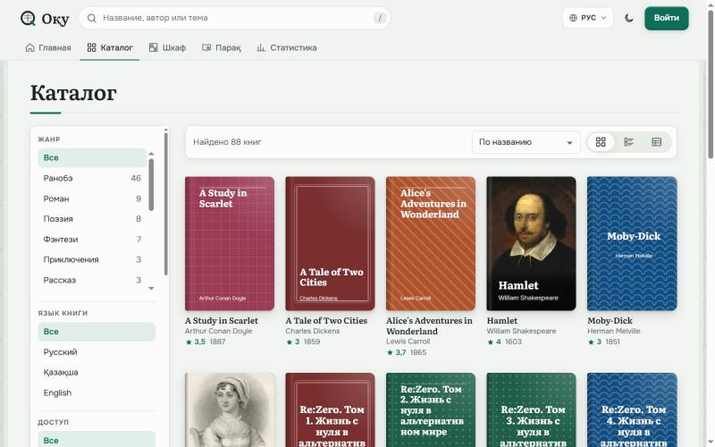


### Экран 3. Шкаф (`#/bookcase`)

```
│ Книжный шкаф                                                  │
│ ┌ ЖАНР ─────────────────────────────────────────────────────┐ │
│ │ [▌Все 88] [▌Роман 9] [▌Поэзия 8] [▌Ранобэ 46] …  таблички │ │
│ ├───────────────────────────────────────────────────────────┤ │
│ │ АНИМАЦИЯ [Случайная|Выдвинуть|…|Взлететь]  [⤮ Перемешать] │ │
│ └───────────────────────────────────────────────────────────┘ │
│        🌍        ▤▤▤             🪴     ← предметы на крыше   │
│ ╔════════════════════════════════════╗ ← карниз              │
│ ║ ▌▐ ▌▌▐▐ ▌ ▐▌ ▌ 🕯 ▤▤ ▌▌▐ ⌛         ║ книги, декор          │
│ ╠═════════════[ РОМАН ]═══════════════╣ ← доска с табличкой   │
│ ║ … ещё 3 полки (жанры) …             ║                        │
│ ╚════════════════════════════════════╝                        │
```

Нажатие на корешок → анимация → окно с обложкой, описанием и кнопками «Читать», «Подробнее». «Перемешать» - одна из четырёх анимаций (домино, падение, вихрь, волна): старые книги уходят, новые встают на полки.

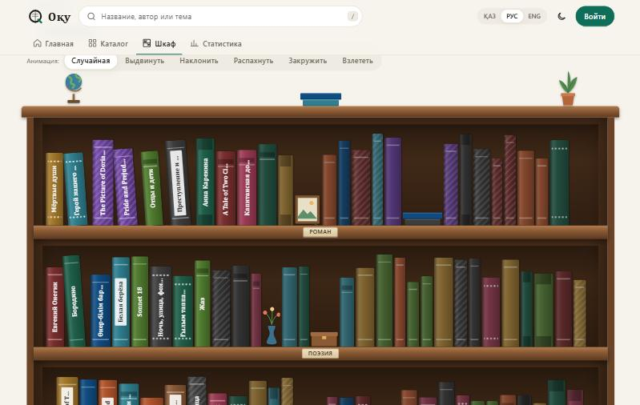

### Экран 3а. Мини-игра «Парақ» (`#/game`)

```
│ «Парақ» - книжный кликер                                     │
│ ┌──────────────────────────┐ ┌ Улучшения ──────────────────┐ │
│ │        1 234             │ │ [🔖 Закладка  +1 за нажатие  18 │ 3] │
│ │       СТРАНИЦ            │ │ [🎓 Студент   0,5 стр./сек   60 │ 2] │
│ │ 4,0 стр./сек · 4 за клик │ │ [☀ Лампа     3 стр./сек    300 │ 1] │
│ │      ┌─────────┐         │ │ … полка, зал, типография, библиотека │
│ │      │ 📖 книга │ ← нажимать│ │ ОСОБЫЕ: Едіге-спамер, Алтынбек │
│ │      └─────────┘  +4      │ │ одобрил, ИИ-амбассадор, …     │
│ │ ╔═ мини-шкаф ═╗ корешки   │ │ Рекорды: 1. … 2. … 3. …       │
│ │ ╚═════════════╝ за покупки│ └─────────────────────────────┘ │
│ │ [Войти] [Начать заново]   │                                 │
│ └──────────────────────────┘                                  │
```

Недоступные улучшения приглушены; купленное добавляет корешок в мини-шкаф. Прогресс вошедшего сохраняется на сервере раз в 20 секунд.

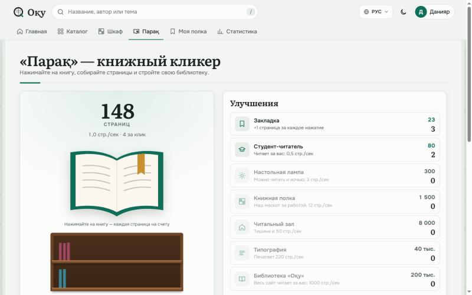

### Экран 4. Карточка книги (`#/book/:id`)

```
│ ┌─────┐  [Платная][Учебник]                                   │
│ │обл. │  Основы Python: от переменной до REST API              │
│ │     │  Команда «Оқу»   ★5 · 1 оценка  ☆☆☆☆☆ (ваша)           │
│ └─────┘  ┌ 🔒 Это новинка с платным доступом … [Купить 990 ₸] ┐ │
│ [Читать] [Читаю|Буду читать|Прочитано|Брошено]                 │
│ [Скан PDF] [Год][Язык][Формат][Прочитали]                       │
│ [МегаПро↗] О книге …  #теги   [Изменить] [Удалить]              │
│          Комментарии 3: [аватар | имя ·Роль· | текст | ✎ 🗑]   │
```

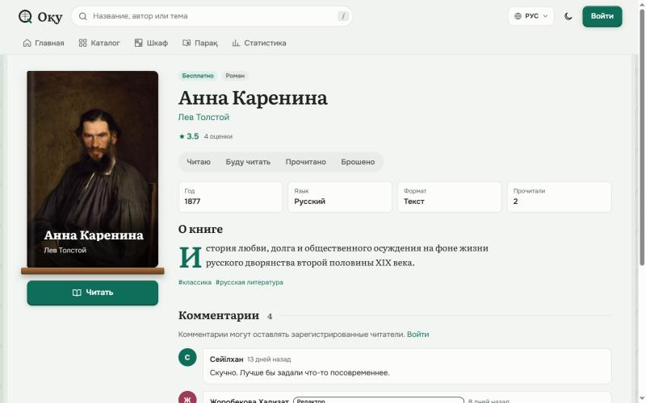

### Экран 5. Читалка (`#/read/:id`)

```
│ [‹] Название книги · 45%          [Текст|PDF] [🔖] [⚙]        │
│ ═════════════════▓▓▓▓▓░░░░░░░░ (полоса прогресса)             │
│            Название                                            │
│            Автор                                               │
│            Текст книги шрифтом с засечками…                     │
│     ┌ Продолжаем с 45% [С начала] ┐  (плашка внизу)            │
```

Панель «Оформление»: размер шрифта, фон «бумага / сепия / ночь», ширина строки. Панель «Закладки»: добавить закладку с заметкой, список, переход.

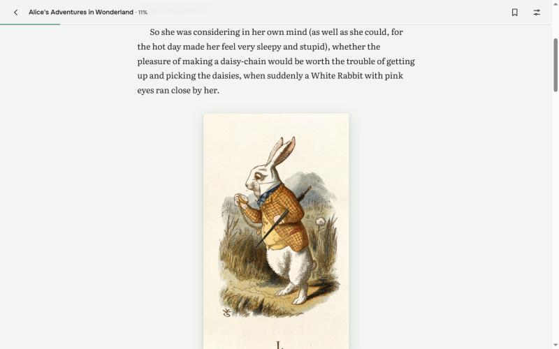

### Экран 6. Вход и регистрация (окно)

```
┌ [Войти | Регистрация] ──────────────── × ┐
│ С возвращением                           │
│ Логин      [            ]                │
│ Пароль     [            ]                │
│ [ Войти ]                                │
│ ▸ Демо-аккаунты: [muhan Главный разр.] … │
└──────────────────────────────────────────┘
```

Регистрация добавляет: имя, e-mail, подсказку о пароле и обязательную галочку «Я принимаю Пользовательское соглашение и даю согласие на обработку персональных данных согласно Политике конфиденциальности». Забаненный пользователь вместо входа видит причину и срок бана и форму заявки на разбан.


### Экран 7. Моя полка (`#/shelf`)

Вкладки «Читаю / Буду читать / Прочитано / Брошено» со счётчиками; плитка книг, у «Читаю» - полоса прогресса.

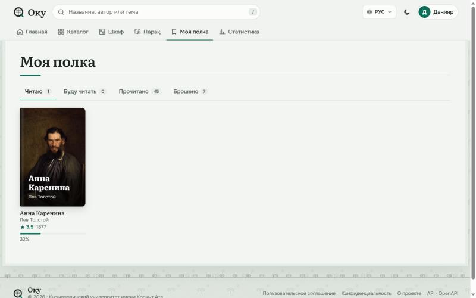

### Экран 8. Профиль (`#/profile`, `/student`, `/settings`)

Шапка профиля (аватар-инициал, имя, роль, «с нами с …»); вкладки: **Обзор** (счётчики полок, «Продолжить чтение», закладки), **Статус студента** (загрузка фото студбилета, статус заявки), **Настройки** (имя, смена пароля, язык, тема, удаление аккаунта).

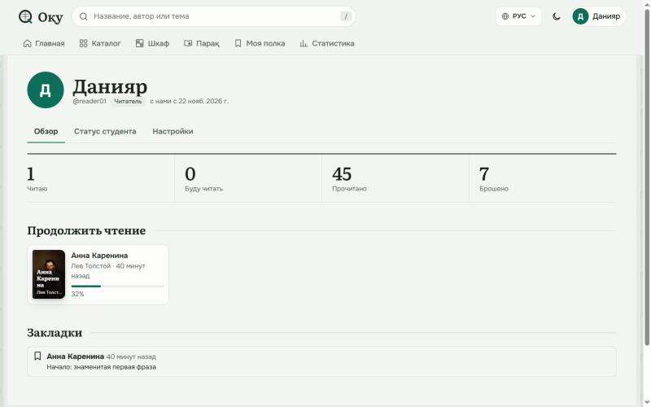

### Экран 9. Статистика (`#/stats`)

Счётчики; «Самые читающие»: 0-е место - главный разработчик (∞, вне конкурса), затем 1, 2, 3…; «Чаще всего дочитывают»; полосы «Книги по жанрам».

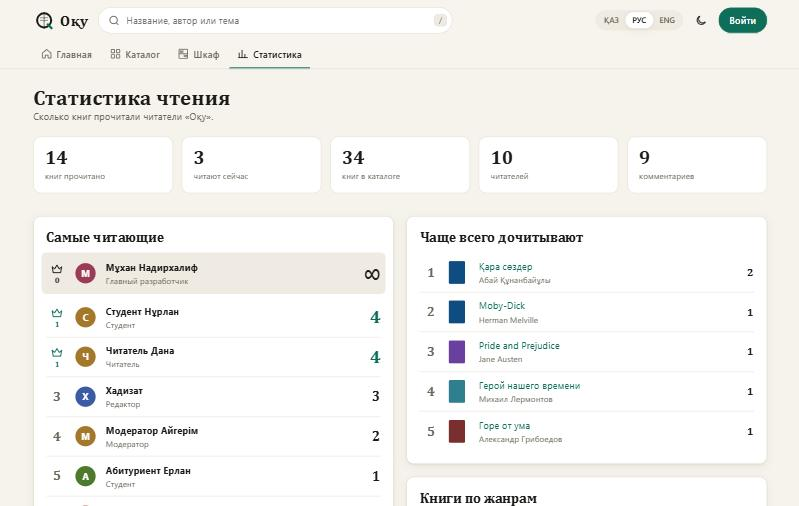

### Экран 10. Редактор книги (`#/books/new`, `#/books/:id/edit`)

Слева карточки «Основное» (название, автор, год, язык, жанр, описание, теги-чипсы, ссылка на оригинал), «Содержимое» (текст, загрузка .txt, PDF-скан), «Доступ» (платная новинка: цена, срок). Справа - живой предпросмотр обложки, палитра цветов и выбор узора.


### Экран 11. Модерация (`#/admin/...`)

Вкладки по правам роли: **Пользователи** (поиск, таблица, смена роли - только главный разработчик, «Забанить / Разбанить», подтверждение студента, удаление), **Заявки на разбан**, **Студенты** (фото студбилета, «Одобрить / Отклонить»), **Журнал действий** (фильтры по действию и датам, таблица «время - пользователь - действие - подробности - IP», постраничный вывод, кнопка CSV).

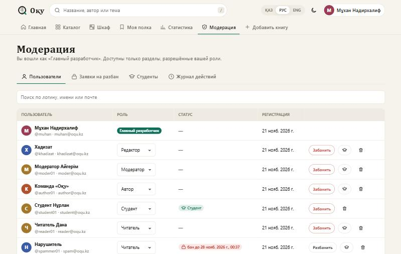

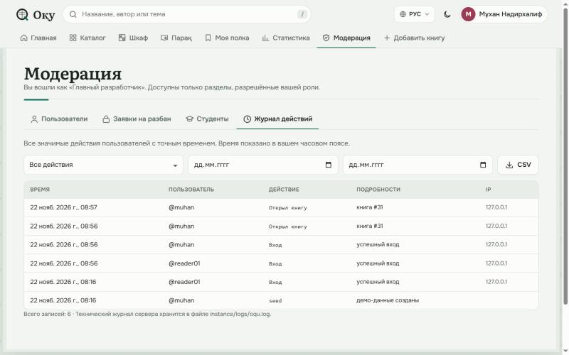

### Экран 12. Юридические страницы (`#/terms`, `#/privacy`, `#/about`)

Текст с оглавлением на выбранном языке; «О проекте» - команда, технологии, ссылки на Swagger UI и ReDoc, благодарности.

### Экран 13. Документация API (`/docs`)

Swagger UI: группы маршрутов, модели, кнопка **Authorize** для ввода токена, кнопка «Try it out» для вызова.

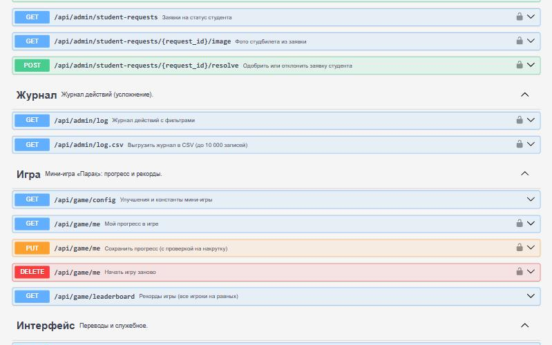

### Экран 14. Телефон

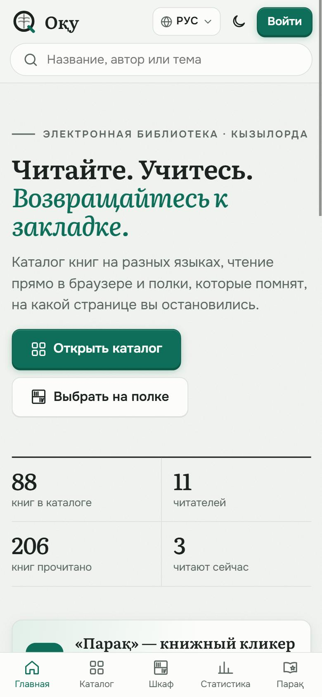
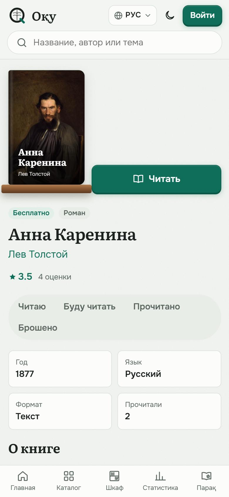
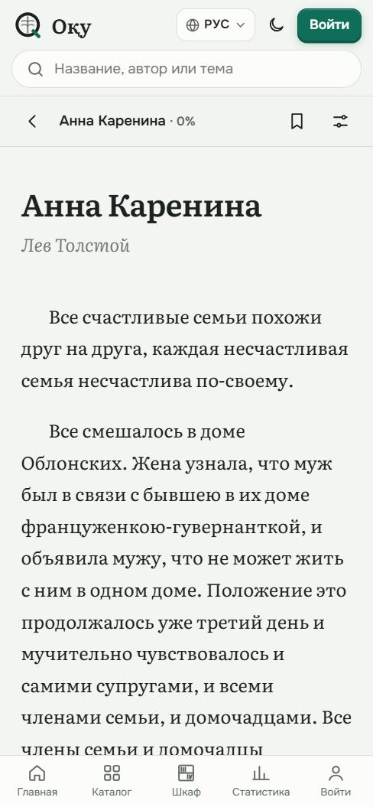
