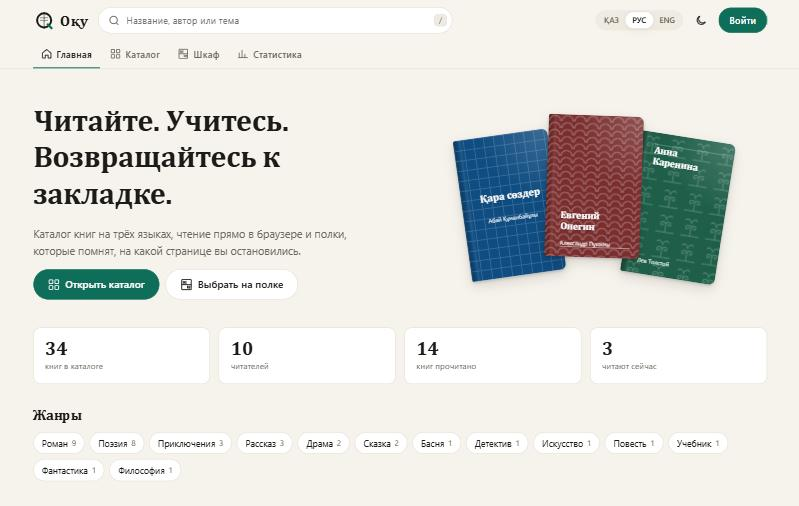
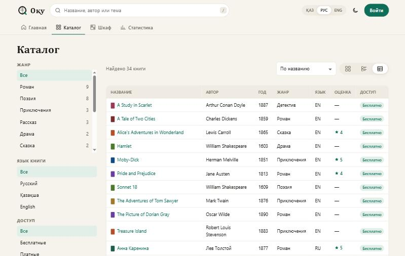
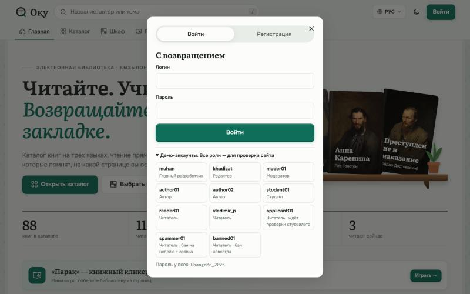
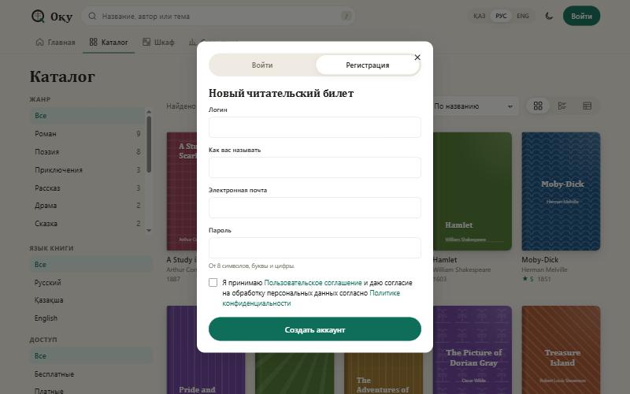
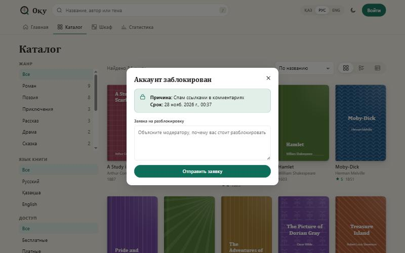
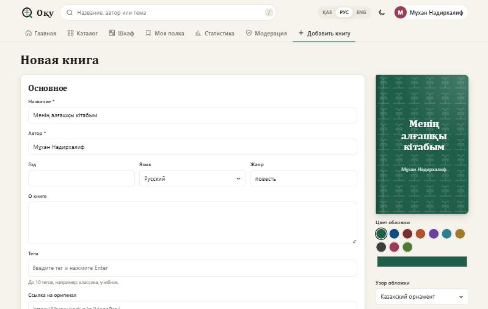
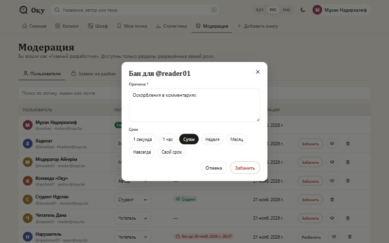

# Документ 4. Макеты интерфейса

**Проект:** «Оқу» · **Версия:** 2.0 от 21.11.2026

Для каждого экрана приведены схема расположения элементов и скриншот реализованной версии 2.0 (скриншоты сделаны с той версии, которая сдаётся на защите).

## 1. Общие принципы

- **Правило трёх цветов 60–30–10:** 60% — «бумага» (фон `#f6f3ec`, карточки), 30% — «чернила» (текст `#1c1b18`), 10% — акцент «зелёная лампа» (`#0f6e5a`: главные кнопки, ссылки, активный пункт, звёзды). Красный — только для ошибок. Есть тёмная тема с теми же ролями цветов.
- **Шапка всегда сверху:** логотип, поиск (горячая клавиша `/`), переключатель языка ҚАЗ / РУС / ENG, тема, вход или меню аккаунта; под ней — меню разделов.
- **Телефон (≤ 720 px):** поиск во второй строке шапки, меню разделов заменяется нижней панелью из 5 вкладок (как в мобильных приложениях), окна открываются снизу.
- **Обложки** рисуются кодом: цвет + один из 10 узоров (в т.ч. казахский орнамент) + название; отдельные картинки не нужны.
- Ошибки форм — под конкретным полем, красной рамкой и понятным текстом.

## 2. Экраны

### Экран 1. Главная (`#/`)

```
┌──────────────────────────────────────────────────────────────┐
│ [Q Оқу] [🔍 Поиск…            /]   [ҚАЗ|РУС|ENG] [☾] [Войти]  │
│ Главная  Каталог  Шкаф  Моя полка  Статистика  Модерация      │
├──────────────────────────────────────────────────────────────┤
│ Читайте. Учитесь.                        ┌──┐┌──┐┌──┐         │
│ Возвращайтесь к закладке.                │  ││  ││  │ обложки │
│ [Открыть каталог] [Выбрать на полке]     └──┘└──┘└──┘         │
│ Продолжить чтение: [обложка | название | ▓▓▓░░ 45%] × 4        │
│ [34 книги] [10 читателей] [24 прочитано] [4 читают]            │
│ Жанры: (Роман 9) (Поэзия 8) (Приключения 3) …                  │
│ Новые поступления  ◀ [обл][обл][обл][обл][обл] ▶   Все →      │
│ Чаще всего дочитывают ◀ … ▶      Высокие оценки ◀ … ▶          │
└──────────────────────────────────────────────────────────────┘
```



### Экран 2. Каталог (`#/catalog`) — три режима вида

```
│ Каталог                                                      │
│ ┌ Фильтры ───────┐  Найдено 34 книги   [По названию ▾] [▦|☰|▤] │
│ │ Жанр: Все/Роман│  (׫абай») (×Казахский)                     │
│ │ Язык книги     │  ┌──┐ ┌──┐ ┌──┐ ┌──┐ ┌──┐                    │
│ │ Доступ         │  │  │ │  │ │  │ │  │ │  │   плитка /          │
│ │ Год: с … по …  │  └──┘ └──┘ └──┘ └──┘ └──┘   список / таблица  │
│ │ Автор, Теги    │  ★4,5 1886 …                                │
│ └ [Сбросить]─────┘         [◀] 1 [2] … [▶]                     │
```




### Экран 3. Шкаф (`#/bookcase`)

```
│ Книжный шкаф        (Все)(Роман)(Поэзия)…        [⤮ Перемешать] │
│ Анимация: [Случайная|Выдвинуть|Наклонить|Распахнуть|Закружить|Взлететь] │
│        🌍        ▤▤▤             🪴     ← предметы на крыше   │
│ ╔════════════════════════════════════╗ ← карниз              │
│ ║ ▌▐ ▌▌▐▐ ▌ ▐▌ ▌ 🕯 ▤▤ ▌▌▐ ⌛         ║ книги, декор          │
│ ╠═════════════[ РОМАН ]═══════════════╣ ← доска с табличкой   │
│ ║ … ещё 3 полки (жанры) …             ║                        │
│ ╚════════════════════════════════════╝                        │
```

Нажатие на корешок → анимация → окно с обложкой, описанием и кнопками «Читать», «Подробнее».


### Экран 4. Карточка книги (`#/book/:id`)

```
│ ┌─────┐  [Платная][Учебник]                                   │
│ │обл. │  Основы Python: от переменной до REST API              │
│ │     │  Команда «Оқу»   ★5 · 1 оценка  ☆☆☆☆☆ (ваша)           │
│ └─────┘  ┌ 🔒 Это новинка с платным доступом … [Купить 990 ₸] ┐ │
│ [Читать] [Читаю|Буду читать|Прочитано|Брошено]                 │
│ [Скан PDF] [Год][Язык][Формат][Прочитали]                       │
│ [МегаПро↗] О книге …  #теги   [Изменить] [Удалить]              │
│          Комментарии 3: [аватар | имя ·Роль· | текст | ✎ 🗑]   │
```


### Экран 5. Читалка (`#/read/:id`)

```
│ [‹] Название книги · 45%          [Текст|PDF] [🔖] [⚙]        │
│ ═════════════════▓▓▓▓▓░░░░░░░░ (полоса прогресса)             │
│            Название                                            │
│            Автор                                               │
│            Текст книги шрифтом с засечками…                     │
│     ┌ Продолжаем с 45% [С начала] ┐  (плашка внизу)            │
```

Панель «Оформление»: размер шрифта, фон «бумага / сепия / ночь», ширина строки. Панель «Закладки»: добавить закладку с заметкой, список, переход.


### Экран 6. Вход и регистрация (окно)

```
┌ [Войти | Регистрация] ──────────────── × ┐
│ С возвращением                           │
│ Логин      [            ]                │
│ Пароль     [            ]                │
│ [ Войти ]                                │
│ ▸ Демо-аккаунты: [muhan Главный разр.] … │
└──────────────────────────────────────────┘
```

Регистрация добавляет: имя, e-mail, подсказку о пароле и обязательную галочку «Я принимаю Пользовательское соглашение и даю согласие на обработку персональных данных согласно Политике конфиденциальности». Забаненный пользователь вместо входа видит причину и срок бана и форму заявки на разбан.





### Экран 7. Моя полка (`#/shelf`)

Вкладки «Читаю / Буду читать / Прочитано / Брошено» со счётчиками; плитка книг, у «Читаю» — полоса прогресса.


### Экран 8. Профиль (`#/profile`, `/student`, `/settings`)

Шапка профиля (аватар-инициал, имя, роль, «с нами с …»); вкладки: **Обзор** (счётчики полок, «Продолжить чтение», закладки), **Статус студента** (загрузка фото студбилета, статус заявки), **Настройки** (имя, смена пароля, язык, тема, удаление аккаунта).


### Экран 9. Статистика (`#/stats`)

Счётчики; «Самые читающие»: 0-е место — главный разработчик (∞, вне конкурса), затем 1, 2, 3…; «Чаще всего дочитывают»; полосы «Книги по жанрам».


### Экран 10. Редактор книги (`#/books/new`, `#/books/:id/edit`)

Слева карточки «Основное» (название, автор, год, язык, жанр, описание, теги-чипсы, ссылка на оригинал), «Содержимое» (текст, загрузка .txt, PDF-скан), «Доступ» (платная новинка: цена, срок). Справа — живой предпросмотр обложки, палитра цветов и выбор узора.



### Экран 11. Модерация (`#/admin/...`)

Вкладки по правам роли: **Пользователи** (поиск, таблица, смена роли — только главный разработчик, «Забанить / Разбанить», подтверждение студента, удаление), **Заявки на разбан**, **Студенты** (фото студбилета, «Одобрить / Отклонить»), **Журнал действий** (фильтры по действию и датам, таблица «время — пользователь — действие — подробности — IP», постраничный вывод, кнопка CSV).





### Экран 12. Юридические страницы (`#/terms`, `#/privacy`, `#/about`)

Текст с оглавлением на выбранном языке; «О проекте» — команда, технологии, ссылки на Swagger UI и ReDoc, благодарности.

### Экран 13. Документация API (`/docs`)

Swagger UI: группы маршрутов, модели, кнопка **Authorize** для ввода токена, кнопка «Try it out» для вызова.


### Экран 14. Телефон


