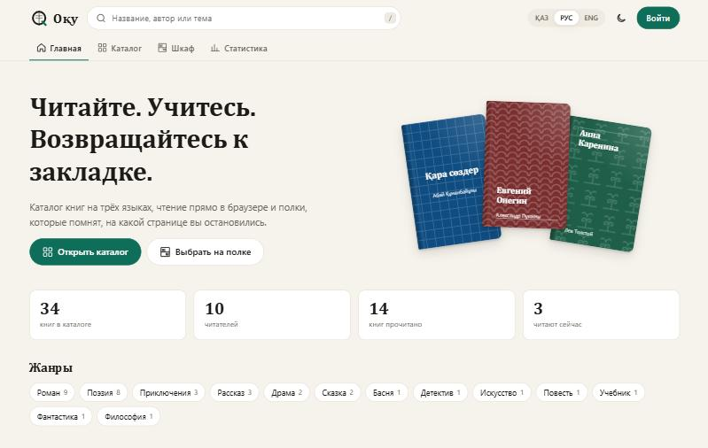
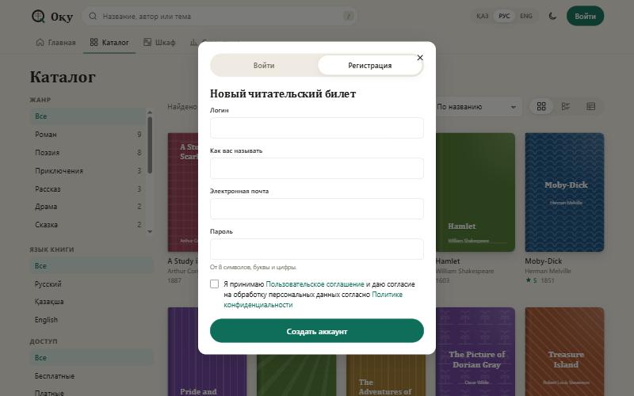
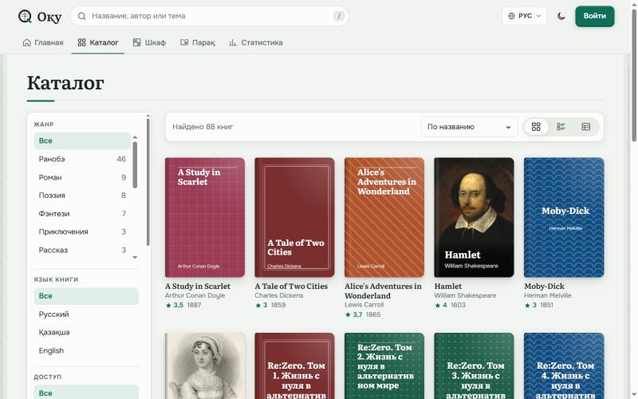
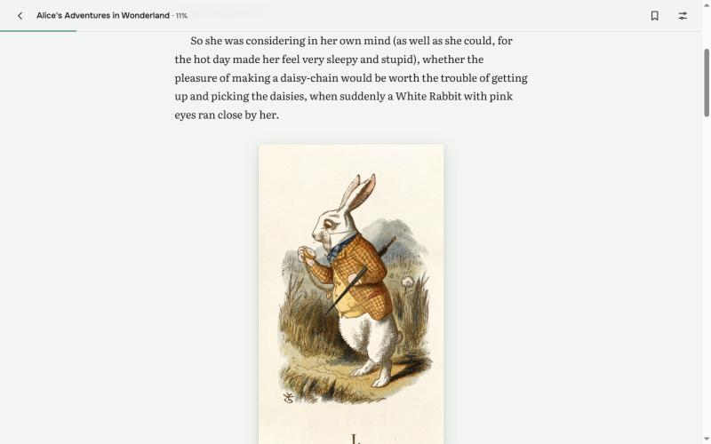
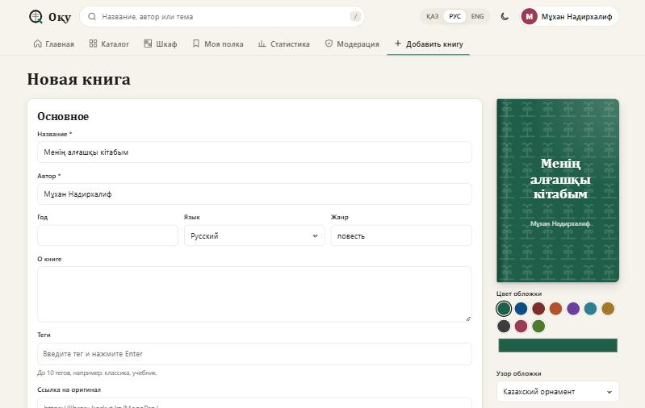
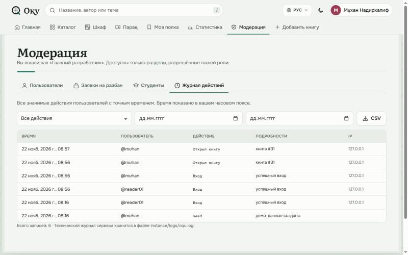

# Документ 7. Руководство пользователя

**Программа:** «Оқу» — электронная библиотека · **Версия:** 2.0 от 21.11.2026

## 1. Назначение и системные требования

«Оқу» — библиотека в браузере: каталог книг на русском, казахском и английском, чтение текста и PDF-сканов, личные полки, закладки, оценки и комментарии. Работает на компьютере и телефоне в браузерах Chrome, Edge, Firefox, Safari. Сервер — любой компьютер с Python 3.11+ (установка — Документ 8).

## 2. Установка и запуск

1. Дважды щёлкните `start.bat` в папке проекта (Windows).
2. Через несколько секунд откроется браузер с адресом <http://127.0.0.1:8000>.
3. Чтобы остановить сервер, закройте чёрное окно консоли.

Для проверки всех ролей используйте демо-аккаунты (пароль у всех `ChangeMe_2026`): `muhan` — главный разработчик, `khadizat` — редактор, `moder01` — модератор, `author01` — автор, `student01` — студент, `reader01` — читатель, `spammer01` и `banned01` — забаненные.

## 3. Экраны

| Экран | Как открыть | Что на нём |
|---|---|---|
| Главная | логотип «Оқу» или «Главная» | «Продолжить чтение», жанры, новинки, популярное, высокие оценки |
| Каталог | «Каталог» или поиск | фильтры слева, сортировка, вид «плитка / список / таблица», страницы |
| Шкаф | «Шкаф» | книги на деревянных полках по жанрам, выбор анимации |
| Книга | нажать на обложку | описание, оценка, статус на полке, чтение, покупка, комментарии |
| Читалка | «Читать» на странице книги | текст или скан, оформление, закладки |
| Моя полка | «Моя полка» (после входа) | книги по статусам |
| Профиль | меню аккаунта → «Профиль» | обзор, статус студента, настройки |
| Статистика | «Статистика» | кто и сколько прочитал |
| Модерация | «Модерация» (модератор, главный разработчик) | пользователи, заявки, журнал |

Скриншоты всех экранов — в Документе 4.

## 4. Типовые сценарии

### 4.1. Как зарегистрироваться

1. Нажмите **«Войти»** в правом верхнем углу → вкладка **«Регистрация»**.
2. Заполните логин (латиница/кириллица, цифры, `._-`, от 3 символов), имя, почту, пароль (от 8 символов, буквы и цифры).
3. Прочитайте Пользовательское соглашение и Политику конфиденциальности (ссылки открываются в новой вкладке) и поставьте галочку согласия.
4. Нажмите **«Создать аккаунт»** — вы сразу войдёте в систему.

Если поле заполнено неверно, оно подсветится красным, а под ним появится подсказка.

### 4.2. Как найти книгу

- Введите слово в строку поиска (или нажмите `/` на клавиатуре) и `Enter` — ищется по названию, автору и описанию.
- В каталоге уточните поиск фильтрами: жанр, язык книги, бесплатные/платные, годы, автор, теги. Активные фильтры видны над результатами — крестик убирает фильтр.
- Справа выберите сортировку и вид: плитка, список или таблица.
- Можно выбрать книгу «на ощупь» в **Шкафу**: выберите жанр и нажмите на корешок.

### 4.3. Как читать и продолжить с того же места

1. На странице книги нажмите **«Читать»** (или **«Открыть скан (PDF)»**, если есть скан).
2. Значок ⚙ — размер шрифта, фон (бумага, сепия, ночь), ширина строки. Листать можно стрелками ← →.
3. Место чтения сохраняется само. В следующий раз нажмите **«Продолжить · 45%»** на странице книги или карточку на главной — читалка откроется на том же месте.
4. Значок 🔖 — добавить закладку с заметкой («повторить к защите») и перейти к любой закладке.
5. Для PDF нажмите **«Я на странице…»**, чтобы запомнить номер страницы.

### 4.4. Как вести полку и оценивать книги

На странице книги выберите статус: **Читаю, Буду читать, Прочитано, Брошено** (повторное нажатие убирает книгу с полки). Звёзды справа от рейтинга — ваша оценка от 1 до 5. Все списки — в разделе **«Моя полка»**.

### 4.5. Как получить платную новинку

- **Студентам бесплатно:** Профиль → **«Статус студента»** → выберите фото студенческого билета (JPG/PNG/WebP до 5 МБ) → **«Отправить на проверку»**. Когда модератор одобрит заявку, новинки откроются. Фото удаляется сразу после проверки.
- **Покупка:** на странице книги **«Купить за … ₸»** → подтвердите. Это учебный проект — деньги не списываются.
- Через указанный срок книга сама станет бесплатной для всех.

### 4.6. Как оставить, изменить и удалить комментарий

Внизу страницы книги напишите текст (до 2000 символов) и нажмите **«Отправить»**. Под своим комментарием есть кнопки **«Изменить»** и **«Удалить»**. Грубые слова автоматически скрываются звёздочками. Рядом с именем персонала показывается приписка роли: «Разработчик», «Редактор», «Модератор», «Автор этой книги».

### 4.7. Как добавить книгу (автор, редактор)

1. Меню **«Добавить книгу»**.
2. Заполните название и автора (обязательно), год, язык, жанр, описание, теги (Enter после каждого).
3. Добавьте текст (вставьте или загрузите `.txt`) и/или PDF-скан до 40 МБ. Можно указать ссылку на книгу в МегаПро.
4. Выберите цвет и узор обложки — справа сразу виден результат.
5. Для платной новинки отметьте «Платная новинка», укажите цену и срок в днях.
6. **«Опубликовать»**. Изменить или удалить книгу можно кнопками на её странице (автор — только свои книги).

### 4.8. Модерация (модератор, главный разработчик)

- **Забанить:** Модерация → Пользователи → **«Забанить»** → причина (обязательно) и срок: 1 секунда, час, сутки, неделя, месяц, навсегда или свой срок. Пользователь увидит причину при входе.
- **Заявки на разбан:** вкладка «Заявки на разбан» — текст заявки и причина бана, кнопки «Одобрить / Отклонить».
- **Студенты:** вкладка «Студенты» — фото билета (нажмите, чтобы увеличить), «Одобрить / Отклонить».
- **Роли** (только главный разработчик): выпадающий список роли в таблице пользователей.
- **Журнал действий:** вкладка «Журнал действий» — фильтр по типу действия и датам, кнопка **CSV** выгружает журнал для Excel.

### 4.9. Если вас заблокировали

При входе откроется окно с причиной и сроком бана. Напишите модератору, почему вас стоит разблокировать, и нажмите **«Отправить заявку»**. После истечения срока бан снимается сам.

### 4.10. Настройки и удаление аккаунта

Профиль → **«Настройки»**: имя, смена пароля (нужен текущий), язык, тема. **«Удалить аккаунт»** удаляет профиль, полки, закладки, оценки и комментарии безвозвратно — потребуется ввести пароль. Язык также переключается кнопками **ҚАЗ / РУС / ENG** в шапке, тема — значком луны/солнца.

## 5. Сообщения об ошибках

| Сообщение | Что означает | Что делать |
|---|---|---|
| «Обязательное поле» под полем | поле не заполнено | заполнить |
| «Не больше 1 000 000» / «Не короче 8 символов» | значение вне допустимых границ | исправить значение |
| «Неверный логин или пароль» | ошибка при входе | проверить раскладку и Caps Lock |
| «Слишком много попыток. Повторите позже.» | сработала защита от подбора пароля | подождать 15 минут |
| «Слишком много попыток входа с этого адреса» | более 10 попыток в минуту | подождать минуту |
| «Аккаунт заблокирован» | бан модератора | подать заявку на разбан в том же окне |
| «Книга платная: купите её или подтвердите статус студента» | у вас нет доступа к новинке | купить или подтвердить статус студента |
| «У вашей роли нет доступа к этому действию» | действие не разрешено роли | обратиться к главному разработчику |
| «Нет связи с сервером» | сервер выключен или нет сети | проверить, запущен ли `start.bat` |

## 6. Контакты разработчиков

Мұхан Надирхалиф (главный разработчик), Жоробекова Хадизат (редактор) — студенты Кызылординского университета имени Коркыт Ата. Раздел сайта «О проекте».
